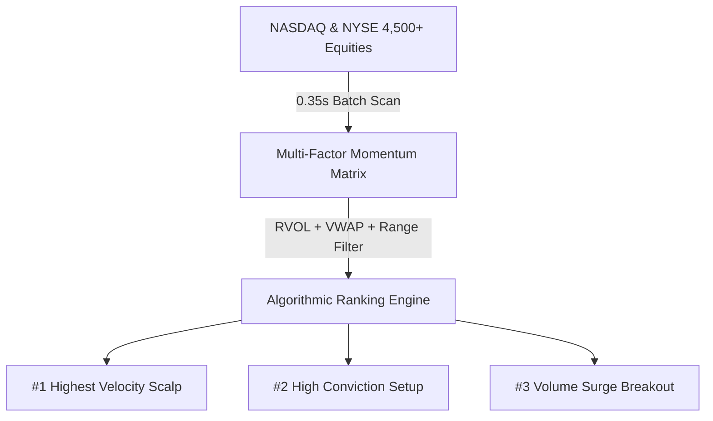

# How to Automate a Full-Universe NASDAQ & NYSE Momentum Scalp Terminal with TradingView and AI

**SEO Title:** Build an Automated AI Trading Terminal: Scan 4,500+ NASDAQ & NYSE Stocks in Real Time  
**Meta Description:** Learn how to monitor every stock on NASDAQ and NYSE in real time, isolate the Top 3 momentum scalp setups, and sync directly with TradingView Desktop via AI.  
**Focus Keywords:** AI Trading System, TradingView Automation, Momentum Scalping Terminal, NASDAQ Stock Scanner, Pine Script v5, Algorithmic Trading  
**Author:** Henry Koh  

---

Every morning at 9:30 AM Eastern Time, millions of dollars slosh across US equities in fractions of a second. Biotech companies spike on clinical trial announcements. Semiconductor suppliers rally on enterprise contracts. 

For retail day traders, the primary hurdle isn't execution—it’s **attention**. 

With more than **4,500 actively traded stocks** listed across NASDAQ, the New York Stock Exchange (NYSE), and AMEX, human eyes physically cannot monitor the market in real time. By the time a stock is featured on financial media or trending on Twitter, the high-velocity upward momentum has typically passed, leaving latecomers trapped at the top of the curve.

In this comprehensive guide, we examine the architecture, mathematics, and operational workflow of **ALPHA-3**: an open-source, singular AI trading system that continuously scans the entire US equity universe in under **0.35 seconds**, isolates the **Top 3 high-probability scalp setups**, and directly controls your **TradingView Desktop application**.

---

## The Structural Challenge of Modern Day Trading

Manual market monitoring presents three fundamental bottlenecks:

1. **Volume Latency:** Standard retail screeners poll quotes every 30 to 60 seconds. In micro-momentum scalping, a 60-second delay means missing a 3% candle entirely.
2. **False Breakout Traps:** High percentage gainers often lack institutional volume. Buying a low-float penny stock without relative volume backing leads to immediate slippage and trap dumps.
3. **Execution Friction:** Navigating between screeners, charting platforms, and broker order tickets takes 15 to 45 seconds—far too slow when capturing a 90-second upward momentum impulse.

---

## How the "Alpha-3" Momentum Matrix Works

To cut through market noise, ALPHA-3 replaces guesswork with a **multi-factor quantitative scoring engine** (`0.0` to `99.9` points) calculated across every active US stock:

| Pillar | Metric | Weight | Institutional Rationale |
|---|---|---|---|
| **Pillar 1** | **Relative Volume (RVOL)** | Up to 35 pts | RVOL $\ge$ 5x to 50x proves institutional capital is entering the order book. |
| **Pillar 2** | **VWAP Position & Delta** | Up to 30 pts | Price expanding above Volume Weighted Average Price proves buyers control the intraday trend. |
| **Pillar 3** | **Session High Structure** | Up to 20 pts | Consolidating within top 5% of the day’s high/low range establishes clean continuation breakouts. |
| **Pillar 4** | **RSI-7 Momentum Band** | Up to 15 pts | RSI-7 between 55 and 82 captures fast momentum acceleration while avoiding parabolic climax exhaustion. |



---

## Direct Desktop Integration: TradingView via Chrome DevTools Protocol (CDP)

Unlike typical web screeners that remain isolated from your charting software, ALPHA-3 integrates directly with the **TradingView Desktop application**.

Because TradingView Desktop is built on an Electron foundation, launching it with remote debugging enables external programmatic interaction:

```bash
/Applications/TradingView.app/Contents/MacOS/TradingView --remote-debugging-port=9222
```

Through the open-source **Model Context Protocol (MCP)** bridge, clicking **`⚡ SYNC DESKTOP`** inside the ALPHA-3 cockpit sends a local command that immediately switches your physical TradingView chart to that ticker on the **1-minute candlestick timeframe**, with all Pine Script support/resistance levels automatically plotted.

---

## Manual Trading vs. ALPHA-3 Automated Terminal

| Feature | Manual Retail Trading | ALPHA-3 AI Terminal |
|---|---|---|
| **Market Coverage** | 4 to 8 watched tickers | **4,500+ NASDAQ & NYSE stocks** |
| **Scan Speed** | 30–60 second manual refresh | **0.35 second automated cycle** |
| **Setup Filtering** | Subjective, emotional chart reading | **Objective 4-pillar quantitative score** |
| **Bracket Generation** | Manual mental calculation | **Automated Target 1, Target 2, and VWAP Stop** |
| **Chart Switching** | Typing tickers manually | **1-Click instantaneous CDP sync** |
| **Risk / Reward** | Inconsistent, variable | **Enforced minimum 1 : 2.5 ratio** |

---

## Step-by-Step Installation & Deployment

ALPHA-3 is 100% open-source and runs locally on macOS, Linux, or Windows without paid SaaS subscription fees.

### Step 1: Clone the GitHub Repository
```bash
git clone https://github.com/henrynkoh/AI_Trading.git
cd AI_Trading
```

### Step 2: Install Python Dependencies
```bash
pip install -r requirements.txt
```

### Step 3: Launch TradingView Desktop in Debug Mode
```bash
./launch_tradingview.sh
```

### Step 4: Start the Web Cockpit
```bash
python3 server.py
```
Open **`http://localhost:5001`** in any modern web browser to access your terminal cockpit.

---

## Frequently Asked Questions (FAQ)

### Does ALPHA-3 require a paid TradingView plan?
No. ALPHA-3 connects to the standard free or paid TradingView Desktop application via local Chrome DevTools Protocol.

### Is real money risked during testing?
No. By default, `DRY_RUN=true` is enabled in `.env`. All scalp orders are executed in zero-risk local simulation mode until you explicitly configure live broker credentials.

### Can I connect Claude Code for chart analysis?
Yes. The repository includes an integrated TradingView MCP server compatible with Anthropic's Claude Code CLI. You can prompt Claude directly from your terminal to review live chart patterns and backtest custom Pine Script strategies.

---

## Conclusion & Open-Source Access

Algorithmic trading no longer belongs exclusively to quantitative hedge funds. By pairing real-time full-market scanning with local TradingView automation, retail traders can execute momentum scalps with institutional speed and discipline.

Explore the source code, review the documentation, and launch your local terminal today:

👉 **Official GitHub Repository:** [https://github.com/henrynkoh/AI_Trading](https://github.com/henrynkoh/AI_Trading)
